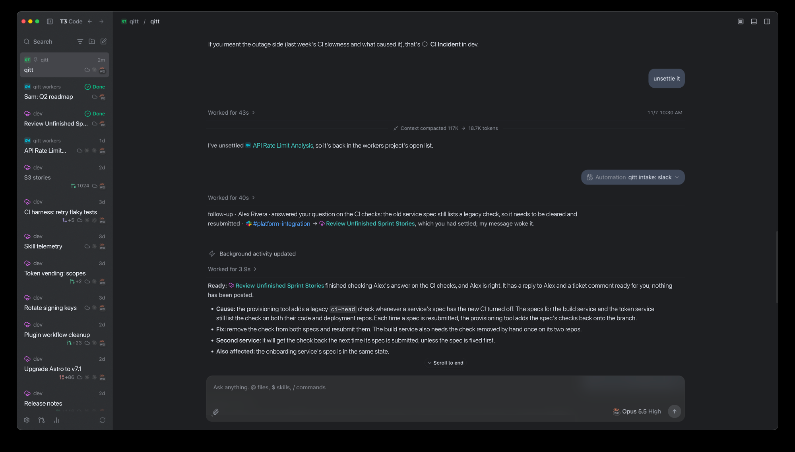

In my [last post](/posts/t3code-control-plane/), I explained why [T3 Code](https://t3.codes/) became the place where all my coding agents live. This post is about **qitt**, my proactive AI chief of staff. It watches everything that reaches me on Slack and in JIRA, so it always knows what I'm working on. When something needs my attention, it starts the research before I get to it and leaves a draft reply for me to review.

## The first version, which I never used

The idea isn't new for me. Early this year, when OpenClaw came out, I built my own always-on assistant, the first qitt. It ran as a service on my Mac, talked to me through Discord, kept its own long-term memory, and indexed everything I touch at work: Slack, JIRA, GitHub, Google Drive and email.

Two months and about 280 commits later, I almost never used it. It lived in Discord, away from where I actually work, and it mostly waited for me to ask it something. I had to remember to go and talk to it, and I rarely did. A chief of staff shouldn't wait for me to come and ask. It should come to me.

## The second version, on T3 Code

Then this fall, three companies shipped the same idea:

- **[Grok Bot](https://x.ai/news/introducing-grok-bot)** (xAI, August): "a chief of staff sits on top, with a specialist for each lane."
- **[dots](https://www.datacamp.com/blog/openai-dots)** (OpenAI, DevDay in September): always-on ChatGPT agents that work in the background.
- **[Claude Duet](https://support.claude.com/en/articles/17631495-get-started-with-claude-duet)** (Anthropic, research preview since October): a proactive agent with daily briefings.

I love the idea. What I don't love is that each one is vendor specific.

By then, I was running all my agents on T3 Code. So the question became: what if qitt lived there, right next to the work it's supposed to watch? And what if, this time, it didn't wait for me to ask? That's when I decided to rebuild [qitt](https://github.com/bquenin/qitt) from scratch on top of T3 Code as an open-source project.

On T3 Code, qitt isn't tied to any one vendor. The threads it starts, which I call workers, can run on Claude, Codex, Cursor, or whatever T3 Code supports next. Today I run everything on Claude, because that's what works best for me right now. When something better comes out, from any vendor, switching is a setting, not a migration.

## Proactive is the point

I can ask qitt anything about my work without giving it context: "what's waiting on me?", "any feedback on that PR yet?", "which thread is handling this?" That's useful, but it's the easy part. Any agent reading my threads can answer those questions.

The part I care about most is what it does before I ask, especially when Slack gets busy.

One Friday morning in late October, 42 things reached me before noon: DMs, replies in threads I was part of, ticket updates, questions in team channels. qitt saw every one of them first, and handled them the way I would have:

- **25 continued work already in progress,** so each went to the thread that owned it.
- **9 needed research,** so each got its own worker: new tickets, and questions from other teams.
- **8 were thanks and acknowledgments,** each closed with a one-line reason.

qitt went through all of it without me asking for anything: it set the noise aside and started the research on what actually needed me.

The research is real work, not just a summary. When a colleague asked me about an issue on one of our clusters, the worker confirmed the fix had landed, found a second problem nobody had asked about, and left a draft reply proposing the fix.

## A fast track, not autopilot

None of this means I can start qitt and lean back. I'm still the one doing the job. On that Friday morning, I still read every report, decided what to do with each one, and wrote or edited every reply that went out. Reports are sometimes wrong, or answer a slightly different question, and catching that is on me.

What qitt takes away is everything before the real work: noticing what came in, figuring out what it's about and who already owns it, and gathering what I'd need to know to answer. When I sit down to a request, the context is there, the research has started, and I have a draft to react to instead of a blank page.

It doesn't do my job for me. It gets me to the part of my job that needs me, faster.

It doesn't speak for me either. qitt is built around two rules:

## Rule one: it never sends anything for me

On the first day of the rebuild, I wrote down the rule I cared about most: "I'll be fully in control, qitt doesn't send reply for me, just be proactive and let me review." Proactive about the work, never about my voice.

It isn't just a line in the prompt: the tools that send on Slack are blocked, so neither qitt nor its workers can post. They can only save a draft for me to edit and send.

It also never settles a thread. Deciding that something is done is my call.

## Rule two: only T3 Code constructs

The second rule, also from day one: "we have to stick to t3code constructs, which are essentially threads, and qitt, aka the chief of staff, as a pinned thread."

So that's what it is:

- **The chief of staff is one pinned thread.** Its project folder holds a charter, an `AGENTS.md` that says what it does and doesn't do.
- **Workers are ordinary threads** that it starts. They land in my sidebar like any other thread, and I read, settle or snooze them the same way.
- **Triggers are T3 Code scheduled tasks** bound to the pinned thread: a webhook for Slack, a webhook for JIRA, and a weekday morning sweep of tickets.

_The pinned qitt thread and its workers. Names and details changed._

The only code outside T3 Code is a small bridge that keeps a connection open to Slack.

## Three weeks of numbers

It went live on October 16, and I've used it at work every day since. In those three weeks:

- It handled about **940 incoming items**: 435 sent to the thread that already owned them, 367 closed on its own as needing nothing from me (mostly thanks and acks), 93 handed to a new worker for research, 41 summarized for me to decide, and 4 kept as reminders.
- Its workers wrote **166 drafts**. I sent every message that went out.
- The pinned thread holds about **4,000 messages**. Only 64 of them are mine. The rest are Slack batches, JIRA events and worker reports. For every message I typed, it triaged about fifteen items on its own.

## Still early

qitt is an early project, and it shows. It has started new threads instead of reusing existing ones, researched the wrong question for an afternoon, and missed messages it should have caught. Each time I see something it could do better, I improve it.

What I like is how that works. When something goes wrong, I say so in the pinned thread, and qitt explains what happened and either proposes a fix or starts a worker to make it. Many of its improvements started as a complaint like that. Even rough around the edges, I'm already hooked, and I can't imagine working without it now.

## Try it

qitt is on GitHub at **[bquenin/qitt](https://github.com/bquenin/qitt)**, under the MIT license. It needs a T3 Code server on a machine that stays on.

For now, it supports Slack and JIRA as event sources. It can be extended to support others, and contributions are welcome.

Everything specific to me, like who I am, my timezone, the channels that matter and how to handle each kind of ticket, lives in a local config folder, not in the repo. Point it at your own workspace with your own config.

It's opinionated and built around how I work. But the idea behind it travels well: your chief of staff should sit where all your agents already are, act before you ask, and never speak for you.
