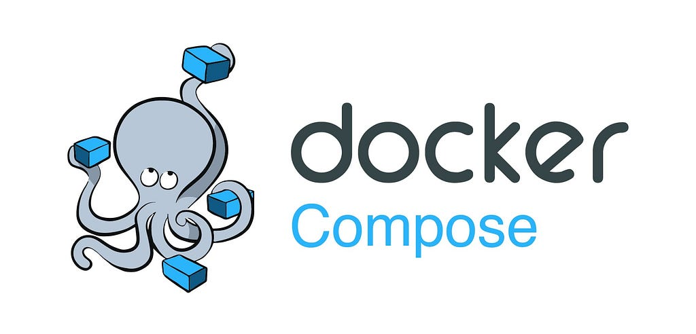

_Originally published on [Medium](https://medium.com/better-programming/modern-rest-api-with-go-and-postgresql-7c916ce2816a) on August 22, 2022._

### Build a Modern REST API With Go — Part 5



This article is the fifth and final in a series covering all the aspects of implementing a modern REST API microservice step by step:

1. [Defining a SQL first data model with sqlc](/posts/build-a-modern-rest-api-with-go-and-postgresql-part-1/)
2. [Implementing the REST API with Gin](/posts/modern-rest-api-with-go-and-postgresql-part-2/)
3. [Configuring with Viper](/posts/configure-your-go-microservice-for-cloud-using-viper/)
4. [Building and running in a container](/posts/optimize-your-go-dockerfile-for-size-and-speed/)
5. **Containerized tests**

All the code for the series is available [here](https://github.com/bquenin/modern-go-rest-api-tutorial).

## What Kind of Tests Should We Implement?

Now that we have built our API microservice, we want to implement tests to ensure it’s working correctly. We have a two-layered service design: the database layer and the HTTP API on top of it. So how are we going to test it?

We could go full-on unit testing by testing each generated SQL query and ensuring it behaves as expected by mocking the actual database. Then, we would test the HTTP API by mocking the database layer and testing each API handler. This is a common approach and makes a lot of sense.

Another way would be to do integration tests. The idea of integration tests is to test your application only using its public APIs. So in our case, we would:

1. Start the database and the microservice, precisely like the production stack in the previous article,
2. Then we would implement a REST API test client, which would call the microservice API to test all the provided methods.

This is also commonly used to test a microservice-based architecture and ensure the whole application or its subsystems behave as expected.

However, both approaches present some challenges. On the one hand, going full-on unit testing requires writing a lot of test code, and in our case, testing the database layer is testing the Postgres SQL driver and sqlc generated code. In the same spirit, testing the HTTP layer independently, requiring mocking the database layer, is a lot of code that must be maintained.

On the other hand, integration tests which only rely on APIs are great, but the checks we can implement are limited to what is publicly exposed by the API. We do not want to implement a private API for testing purposes!

### Best of Both Worlds?

So, in this article, we will take the best of both worlds and implement something in-between unit and integration tests:

- To avoid mocking the database, we will start a containerized database to support our tests,
- We will not decouple the client, and the server to enable fine-grained checks but bypass the network layer and perform requests directly on the server.

Please note that this is a very opinionated approach. It is very efficient and will definitely save you a lot of time.

## Grouping Tests under Suites

To write our tests, we will use the [stretchr/testify](https://github.com/stretchr/testify) library to group our tests under [test suites](https://github.com/stretchr/testify#suite-package). Using suites allows us to perform initialization steps before the whole suite and before each test:

```go file=authors_test.go
package authors

// ...

type ServiceTestSuite struct {
	suite.Suite
	router  *gin.Engine
	queries *database.Queries
}

// In order for 'go test' to run this suite, we need to create
// a normal test function and pass our suite to suite.Run
func TestServiceTestSuite(t *testing.T) {
	suite.Run(t, new(ServiceTestSuite))
}

func (suite *ServiceTestSuite) SetupSuite() {
	cfg, err := config.Read()
	suite.Require().NoError(err)

	postgres, err := database.NewPostgres(cfg.Postgres.Host, cfg.Postgres.User, cfg.Postgres.Password)
	suite.Require().NoError(err)

	suite.queries = database.New(postgres.DB)
	service := NewService(suite.queries)

	suite.router = gin.Default()
	service.RegisterHandlers(suite.router)
}

func (suite *ServiceTestSuite) SetupTest() {
	suite.queries.TruncateAuthor(context.Background())
}
```

The **SetupSuite** method is executed once before the execution of the whole suite. We set up the server the same way we do for the main function. The only difference here is that we do not start the server. Everything else is identical: we use the same configuration mechanism, instantiate the database connection in the same way, and register the same handlers.

The **SetupTest** method is executed before every test of the suite. In our case, we truncate the author database to start with a clean slate.

## Implementing tests

```go file=test_create.go
func (suite *ServiceTestSuite) TestCreate() {
	request := apiAuthor{
		Name: "test author",
		Bio:  "A test bio",
	}
	var buffer bytes.Buffer
	suite.Require().NoError(json.NewEncoder(&buffer).Encode(request))

	req, err := http.NewRequest("POST", "/authors", &buffer)
	suite.Require().NoError(err)

	rec := httptest.NewRecorder()
	suite.router.ServeHTTP(rec, req)

	suite.Require().Equal(http.StatusCreated, rec.Result().StatusCode)
	var author apiAuthor
	suite.Require().NoError(json.NewDecoder(rec.Result().Body).Decode(&author))
	suite.Require().Equal(request.Name, author.Name)
	suite.Require().Equal(request.Bio, author.Bio)
}
```

_TestCreate_

We are using the `httptest` standard test library to test our API. This library can test any HTTP application, especially REST APIs. It enables “recording” requests and responses.

We are building HTTP requests and parsing HTTP responses like for a real server. The only difference is that we bypass the network stack by directly invoking the router’s `ServeHTTP` method. Apart from that, we are testing the code the same way it is executed in production.

After calling the server, we validate the response by asserting each field has the expected value.

```go file=test_update.go
func (suite *ServiceTestSuite) TestFullUpdate() {
	author, err := suite.queries.CreateAuthor(context.Background(), database.CreateAuthorParams{
		Name: "test author",
		Bio:  "A test bio",
	})
	suite.Require().NoError(err)

	update := apiAuthor{
		Name: "this is a better name",
		Bio:  "This is a way better updated bio",
	}
	var buffer bytes.Buffer
	suite.Require().NoError(json.NewEncoder(&buffer).Encode(update))

	req, err := http.NewRequest("PUT", fmt.Sprintf("/authors/%d", author.ID), &buffer)
	suite.Require().NoError(err)

	rec := httptest.NewRecorder()
	suite.router.ServeHTTP(rec, req)

	suite.Require().Equal(http.StatusOK, rec.Result().StatusCode)
	var got apiAuthor
	suite.Require().NoError(json.NewDecoder(rec.Result().Body).Decode(&got))
	suite.Require().Equal(author.ID, got.ID)
	suite.Require().Equal(update.Name, got.Name)
	suite.Require().Equal(update.Bio, got.Bio)
}
```

_TestFullUpdate_

In the above test, we want to test the update handler, but to update an author, we first need to create one. Since we did not separate the client and the server, we can create the required author in the database easily, as illustrated above.

## Running Tests in Containers

We will also use Docker Compose to run containerized tests, as we did in the previous article. To achieve this, we are going to:

1. Build an image including the tests
2. Run this test container image as part of our test stack

### Building the test container

The first step is to build a test container. Please note that **the tests are not executed during this step**. We are only building a container that contains the test code to be executed in the next step:

```dockerfile file=Dockerfile
FROM golang:1.19.0-alpine3.16
WORKDIR /root

# Download module in a separate layer to allow caching for the Docker build
COPY go.mod go.sum ./
RUN go mod download

# Copy source code
COPY api ./api
COPY cmd ./cmd
COPY internal ./internal

CMD CGO_ENABLED=0 go test ./...
```

We copy the source code inside the container and specify the command to execute when the container starts. This command is simply “**go test ./…**” to execute all the tests.

### Run the Test Stack

Now that we have our test container ready, we must define our test stack. We are going to use the same stack as the production stack, except that instead of running the microservice, we will run the tests themselves:

```yaml file=docker-compose.yml
version: "3.9"

services:
  tests:
    image: microservice-tests
    build:
      context: ..
      dockerfile: test/Dockerfile
    environment:
      APP_POSTGRES_HOST: postgres
      APP_POSTGRES_PASSWORD: password

  postgres:
    image: postgres:14.5-alpine3.16
    environment:
      POSTGRES_PASSWORD: password
    configs:
    - source: postgres-schema
      target: /docker-entrypoint-initdb.d/schema.sql
    volumes:
    - postgres-data:/var/lib/mysql

configs:
  postgres-schema:
    file: ../sql/schema.sql

volumes:
  postgres-data:
```

_Docker Compose Test Stack_

The build section for the tests tells Docker Compose to build the container before starting the stack. We are also configuring our tests to use the containerized database.

We can update our Makefile to add a test target:

```makefile file=Makefile
# Test
.PHONY: test
test:
	@docker compose -f test/docker-compose.yml down -v
	@docker compose -f test/docker-compose.yml up --build --abort-on-container-exit --remove-orphans --force-recreate
	@docker compose -f test/docker-compose.yml down -v
```

_Makefile test target_

The Compose command has the following parameters:

- `--build` forces the build of the test container image
- `--abort-on-container-exit` forces the stack to stop when a container exits. It allows stopping the stack when our test container has finished running the tests. The exit status of the test container is propagated to the Compose command, i.e., if tests fail, the Compose command fails too. This is helpful when running tests in a CI/CD pipeline.
- `--force-recreate` forces recreating containers even if their configuration and image haven’t changed.
- `--remove-orphans` removes containers for services not defined in the Compose file.

## Conclusion

This concludes this series about modern REST API using Go. Congratulations on having made it this far! I hope you have enjoyed it as much as I did and found it helpful! Have fun!
