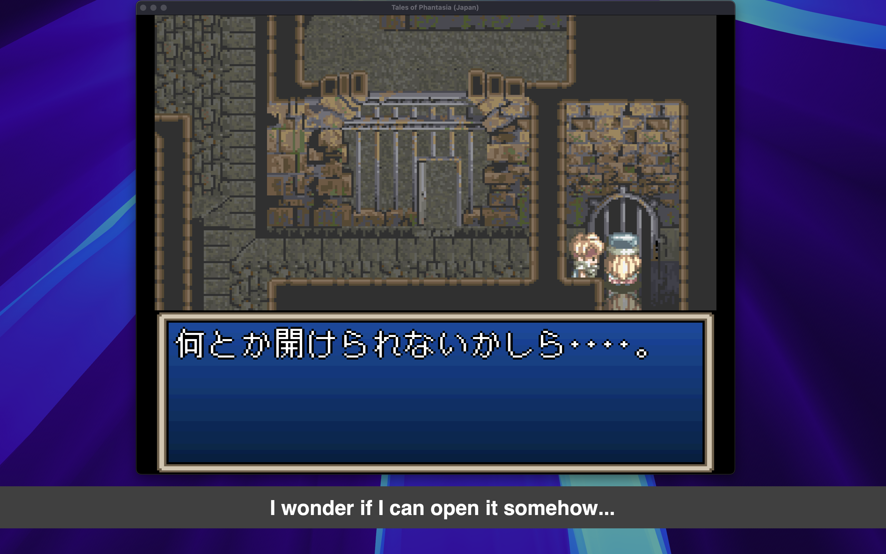

There are hundreds of great Japanese games from the SNES, PlayStation and Saturn era that never got an English release. Fan translations cover some of them, but most will never get one.

A few years ago I built a tool to fix that for myself: point it at an emulator window, and it reads the Japanese text on screen and shows an English translation on top of the game. I called it **[Interpreter](https://github.com/bquenin/interpreter)**.

The first version worked, but almost nobody could use it. This post is about why I rebuilt it from scratch to run **fully offline**, how it works, and what happened when I did.

## Version 1: Go and Google Cloud

The original version, from 2022, was written in Go and used Google Cloud for the hard parts: Cloud Vision for OCR, and Cloud Translation for Japanese to English. I wrote about it at the time in [Translate Any Retro Game on the Fly With Google Cloud AI and Go](/posts/translate-any-retro-game-on-the-fly-with-google-cloud-ai-and-go/).

Technically it was fine. In practice it had a big problem: **to use it, you needed a Google Cloud account**. You had to create a project, enable two APIs, set up billing, create a service account and download a key file. That's a normal Tuesday for a software engineer, and a wall for pretty much everyone else.

It showed. Over three and a half years, the project collected about 60 stars.

## What I wanted instead

I wanted something my non-technical friends could install and use without me on the phone:

- **Free by default.** No API keys, no accounts, no credit card, no usage bill.
- **Offline and private.** Nothing leaves your machine. It works on a plane.
- **Simple.** A one-line install, a window picker and a few sliders. No config files.

When I started v1 in 2022, running good OCR and translation models locally on a regular laptop wasn't realistic. By late 2025, it was.

## How it works

Every refresh, Interpreter runs a four-step pipeline:

1. **Capture.** It grabs the pixels of the window you picked (your emulator), on Windows, macOS or Linux.
2. **OCR.** [MeikiOCR](https://github.com/rtr46/meikiocr) extracts the Japanese text. It's trained specifically on Japanese game text, which matters a lot: general-purpose OCR struggles with low-resolution pixel fonts, and retro games are nothing but low-resolution pixel fonts.
3. **Translate.** [Sugoi V4](https://huggingface.co/entai2965/sugoi-v4-ja-en-ctranslate2), a Japanese-to-English model popular in the visual novel community, translates the text. It runs on [CTranslate2](https://github.com/OpenNMT/CTranslate2), an inference engine efficient enough to run it on a regular laptop.
4. **Display.** The translation appears in an overlay, either as a subtitle **banner** under the game, or **in place**, drawn directly over the original Japanese text and click-through so you can keep playing.

A few details made a big difference:

- **A fuzzy translation cache.** Games redraw the same dialogue box many times, and OCR output can change slightly from frame to frame. Fuzzy matching recognizes "almost the same text" and reuses the previous translation instead of translating again.
- **One-time model download.** The first launch downloads about 1.5 GB of models. After that, everything runs from the local cache, with no network needed.
- **A real GUI.** v2 started as a command-line tool. Four days after the first release I replaced it with a desktop app, because a CLI is exactly the kind of wall I was trying to remove.

## The hard part wasn't the AI

The models were the easy part. The time went into making it work everywhere:

- **Capturing and overlaying windows works differently on every OS.** On Wayland it's deliberately hard: for security, apps aren't allowed to know where other windows are, so the in-place overlay only works with fullscreen games there.
- **Global hotkeys on Linux** need the user to be in the `input` group.
- **Installers.** Getting a Python app with ML dependencies to install with one command on Windows, macOS and several Linux distributions took more iterations than the OCR and translation code combined. Recent fixes include forcing TLS 1.2 for old Windows PowerShell versions and detecting a missing `libxcb-cursor` library on Debian-based distros.

Wayland capture was hard enough that I ended up writing a library for it: **[pipewire-capture](https://github.com/bquenin/pipewire-capture)**. On Wayland you can't just grab another window's pixels: you ask the desktop portal, the user picks the window in a system dialog, and the frames come through PipeWire. I wrote it in Rust with Python bindings and pre-built wheels, so users don't need a compiler or system headers to install it.

## Built with AI agents

I started v2 in December 2025, mostly as an excuse to try my new Claude Max subscription. v2.0.0 shipped on December 30, and I kept iterating with Claude Code, plus some Codex, through January: about 90 commits that month, covering Linux support, Windows fixes, configurable hotkeys and the GUI.

Claude wrote most of the code. My job was closer to product owner and tester: deciding what to build, trying every change on real games and real operating systems, and saying "no, that's not it" a lot. The agents were great at the things I would have spent evenings reading documentation for: macOS Quartz, the Windows Graphics Capture API, xdg-desktop-portal, evdev, PowerShell quirks. They also made it possible to turn a bug report into a fix the same day, which users noticed. What they couldn't do was see the screen: whether the subtitles were readable, whether the overlay landed on the right spot, whether it felt good to play with. That part was still on me. And honestly, with the little time I have for side projects, I don't think v2 would exist without them.

## What happened next

v2 changed everything for the project. In January 2026 alone it got about **520 new stars**, almost ten times what v1 collected in three and a half years. It's now past 800 stars and 40 forks. Most people find it through Reddit, Google and YouTube.

The best part has been the feedback. People open issues to ask for support for their emulator, their GPU or their favorite OCR model, and some send pull requests. Thanks to those requests, Interpreter now also supports source languages other than Japanese, and you can plug in a local LLM through Ollama or any OpenAI-compatible endpoint if you prefer.

A few messages from the issue tracker that made my day:

> "First of all, thank you for this incredible project!" ([#171](https://github.com/bquenin/interpreter/issues/171))

> "This works great on Windows 11, by the way. I really appreciate all the effort you're putting in to this." ([#163](https://github.com/bquenin/interpreter/issues/163#issuecomment-3734821237))

> "Thank you for addressing this issue so quickly!" ([#254](https://github.com/bquenin/interpreter/issues/254#issuecomment-5734403836))

> "Thanks 1k for your amazing project!" ([#275](https://github.com/bquenin/interpreter/issues/275#issuecomment-6229247517))

## My confession

I built all of this to play **Tales of Destiny 2**, which never got an official English release. So far I've only tested Interpreter on Tales of Phantasia (SNES). I still haven't found the time to actually play Tales of Destiny 2 with it.

If you have a Japanese game you've always wanted to play, I'd love for you to try it. It's free and open source (MIT), and installs with one command on Windows, macOS and Linux: everything is on the [GitHub page](https://github.com/bquenin/interpreter). Bug reports, feature ideas and screenshots of what you're playing are all welcome.
