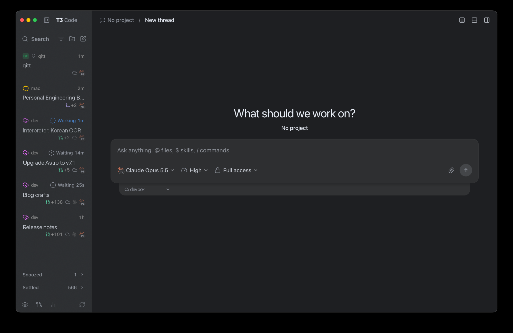

I use several coding agents every day: Claude Code for most things, Codex and Cursor for others. For a while that meant one terminal tab or desktop app per agent, each with its own sessions, its own notifications and its own idea of what "done" looks like. I was spending more time finding my agents than reading what they did.

For the last couple of months, all of them run through **[T3 Code](https://t3.codes/)**. This post is about why it became my control plane for agents, and what it's still missing.

## What T3 Code is

T3 Code is an open-source (MIT) app from Ping.gg, Theo Browne's team. It doesn't ship its own agent. It drives the agent CLIs you already have, signed in with your own subscriptions: Claude Code, Codex, Cursor, Grok Build, OpenCode, Google Antigravity and others. It runs as a desktop app, a web app and mobile apps. It's young: the first alpha came out in March 2026 and the README still says "Expect bugs." It already has over 40,000 GitHub stars.

## One app, any agent

Every conversation is a thread, and every thread picks its provider and model. Threads from different agents sit side by side in the same sidebar, with the same diff view, the same approvals and the same notifications. It's a bit like an email app: one inbox, whichever account a message came from.

That sounds small. In practice it changed how I pick agents: switching costs nothing, so I use whichever one fits the task instead of whichever one is already open. Since I started using T3 Code in September, I've run roughly 240 Claude threads, 200 Cursor threads and 70 Codex threads through it.

Agents can also hand work to each other. T3 Code gives every agent a built-in MCP server, so a Claude thread can delegate a sub-task to Codex or Cursor and get the result back, without me copying anything between windows.

## Threads as an inbox

With a dozen agents running, the hard problem is attention, not compute. The email comparison goes further than the sidebar:

- A thread that needs me shows up as active. One that's done, I **settle**, and it gets out of the way.
- I can **snooze** a thread until a date. I snoozed the thread where I wrote my first blog post until the morning I planned to share it.
- I can tell a thread to **watch a pull request**. It sleeps until CI finishes or someone comments, then wakes up, deals with it and comes back to my inbox.

The result is that I don't poll my agents. They come to me when they need something.

## Agents can drive T3 Code too

This is the part I think is most underrated: agents can use T3 Code itself.

Everyone knows about subagents by now. An agent hands a sub-task to a helper, waits for the answer and carries on, and T3 Code does that too, across providers. But real work doesn't always fit that shape. An agent fixing a build notices a second, unrelated bug. Another one finds something that matters to a thread I started yesterday. A subagent would either derail the current task or lose the finding when it returns.

Through that same built-in MCP server, an agent can do what I would do by hand:

- **Message an existing thread** that owns related work, so the finding lands where the context already is.
- **Start a new thread** for the side problem, so it gets its own focus and shows up in my inbox.
- **Read other threads** to check whether something is already being handled.

That turns T3 Code from a UI for agents into a platform agents can build on.

## The server runs where the work is

The part that sold me: the T3 Code server doesn't have to run on my laptop.

My development environment is a Linux machine in the cloud that's always on. The T3 Code server runs there, next to the code, and the desktop app on my Mac connects to it over SSH. Projects, credentials and agent processes stay on the remote machine. When I close the laptop, nothing stops.

That matters because most of my agent work happens when I'm not watching: overnight, or while I'm away from the keyboard. This spring, Business Insider wrote about developers walking through airports with their laptops half open so their coding agents wouldn't stop. I get to close mine.

## What's not great yet

It's an early project, and it shows:

- **The remote server took some babysitting.** In my first weeks I had two servers end up writing to the same database, an update copied over but never switched on, and sessions stuck after a restart.
- **Some basics arrived late.** Until October, there was no way to search inside a thread. It moves fast, though: find-in-thread shipped about a week after I first went looking for it, and new builds come out every day.
- **The project mostly doesn't accept contributions**, which is fair for a small team moving this fast. So I keep a [small fork](https://github.com/bquenin/t3code) with a handful of patches, for example letting agents on one T3 Code server reach threads on another.

None of this has made me want to go back to one app per agent.

## What's next

Once agents can see and message every other thread, an obvious idea follows: one agent whose job is to watch all the others, and me. Several companies shipped exactly that this year, as an "AI chief of staff". Each one is tied to a single vendor's models. In the next post, I'll show the one I built on top of T3 Code instead.
