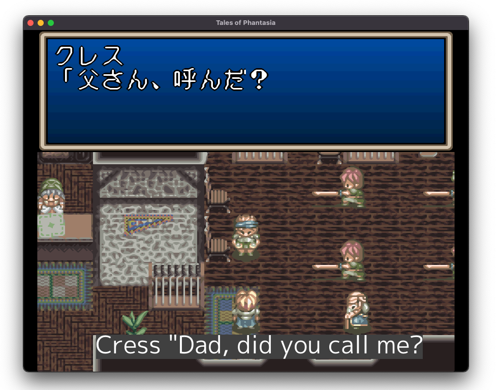
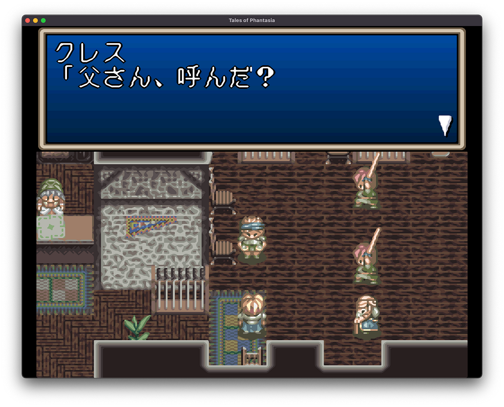
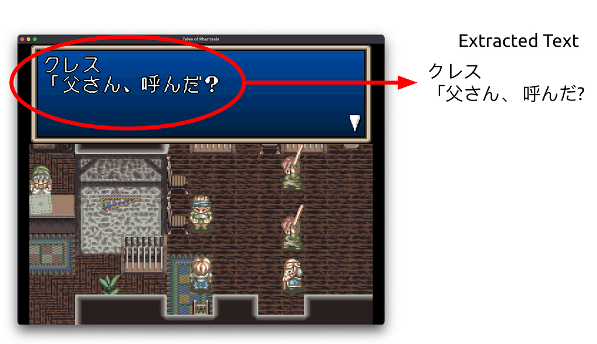
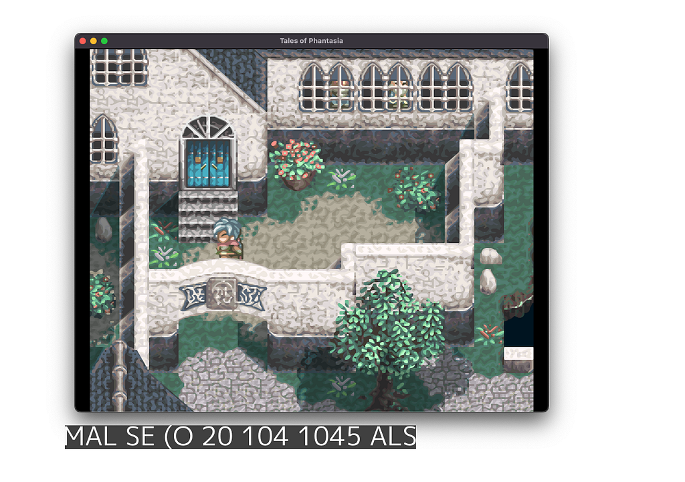
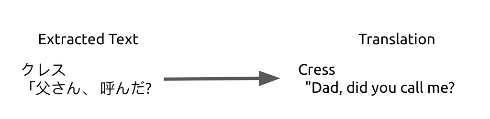

_Originally published on [Medium](https://medium.com/better-programming/translate-any-retro-game-on-the-fly-with-google-cloud-ai-and-go-c0692ab40547) on July 22, 2022._

### Reminiscing classic games? Here’s a guide for you


_Photo by [Viviana Rishe](https://unsplash.com/@vivirishe?utm_source=medium&utm_medium=referral) on [Unsplash](https://unsplash.com?utm_source=medium&utm_medium=referral)_

If you enjoy playing retro games, and especially old RPGs, you’ve probably experienced the highs and lows of discovering this awesome old Japanese RPG that you now desperately want to play but instantly realized it’s never been translated to English and you’re just left with your hopes crushed.

This is now history thanks to Google Cloud AI services!

Using the Google Cloud Vision and Google Translate APIs, I’ve put together a small Go application called [interpreter](https://github.com/bquenin/interpreter) which translates anything on screen to your preferred language.



_Live subtitle with Interpreter_

## How does it work?

The process is actually very simple:

- Take a screenshot of the window we want to translate
- Use Google Vision to extract any text from it
- Use Google Translate to translate it
- Display it back, as subtitles, on the screen

## Taking a screenshot

In order to take a screenshot of a specific window, I had to write a small library called [captured](https://github.com/bquenin/captured). It just takes a screenshot of a specific window:

```go
// Capture window
screenshot, err := captured.CaptureWindowByTitle(a.windowTitle, captured.CropTitle)
if err != nil {
   log.Fatal().Err(err).Send()
}
```



_Screenshot of the game_

## Extracting text from the screenshot

Once you have an image, you can just send it to Google Cloud vision to extract any text from it:

```go
// Extract text from image
annotations, err := vision.DetectTexts(context.Background(), screenshot, nil, 1)
if err != nil {
   log.Fatal().Err(err).Send()
}
```



_Google Vision extracting text from screenshot_

## Everything looks go… hey, wait a minute?



What is this gibberish? It’s definitely not what’s on screen! It turns out that the neural network is trying to interpret anything that resemble text.

A quick look at the [doc](https://cloud.google.com/vision/docs/samples/vision-fulltext-detection) tells us that every result comes with a confidence score along with the extract text. After some tests, it looks like anything that is actual text has a confidence score of 99% or more, but those gibberish results have a confidence score way below 50%. So we just need to filter out the results and keep the ones with a confidence score above 90%.

## Translating the extracted text

Once we have extracted the text from the screenshot, we can translate it in a single call to the Google Translate API. You don’t even need to specify the source language, it will be detected automatically.

```go
// Translate text
resp, err := a.translationClient.Translate(context.Background(), []string{detectedText}, "en", nil)
if err != nil {
   log.Fatal().Err(err).Send()
}
```



_Google Translate_

## Displaying Subtitles

This part is a little bit more complex as it requires a graphics library to draw on screen. I’ve been using the fantastic Go library [Ebitengine](https://ebiten.org/) for this. I’ve left out the details but it’s essentially displaying the translated text on a transparent, always on top window.


_Displaying subtitles on top of the game window_

## Trying it out

Go to [https://github.com/bquenin/interpreter](https://github.com/bquenin/interpreter) and follow the instructions in the [README](https://github.com/bquenin/interpreter#readme) and you should be ready to go in minutes!
