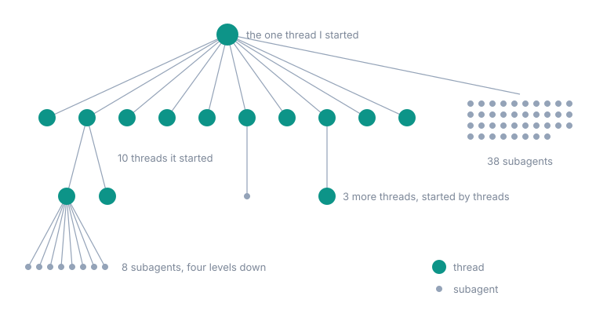

_Yes, yes, graph theory purists: a tree is a graph. It's just not the kind graph engineering has in mind, so let's call it an edge case._

First there was loop engineering. This summer the conversation moved on to [graph engineering](https://www.aibuilderclub.com/blog/graph-engineering-vs-loop-engineering).

I wondered which one I was doing. So I looked at my threads in [T3 Code](https://t3.codes/), where [all my agents live](/posts/t3code-control-plane/). The answer is neither. What I do looks like a tree, and nobody designs it up front.

## Loops and graphs, briefly

- A **loop** is one agent repeating a cycle: try, check, adjust, go again, until a stop condition.
- A **graph** is several agents wired together. Each node is one agent with one job, and each edge is a dependency: the output of one agent feeds the next.

A graph is often described as [a network of loops](https://technologiee.substack.com/p/graph-engineering-build-1000-agent). What the two have in common is that someone decides the shape before the run. You write the stop condition or the wiring, start it, and come back when it's done.

That works when I know what the work involves up front. Often I don't. I find out as I go.

So the difference between a graph and my tree isn't the shape. It's when the shape gets decided: during the work, not before it.

## One thread, and what grew under it

Early this month I started a thread for a migration at work. It turned into about a dozen tickets across several repositories, and it took ten days.

I started that one thread, the root of the tree. Agents started everything else:

- **13 threads**, roughly one per ticket. The root started 10 of them, and those started 3 more.
- **47 subagents** for short jobs: a code search, a round of review fixes, a check of the docs.

_Every thread and subagent under the one thread I started. Large dots are threads, small dots are subagents._

At its deepest, the tree has four levels: the root, a thread it started, a thread that one started, and eight subagents under that.

It's my biggest tree so far, but not the only one. Since mid-October, I've started 43 threads by hand on my dev box. Agents started about 170 more, plus about 210 subagents, counting the ones [my chief of staff](/posts/agent-agnostic-chief-of-staff/) starts.

## Anatomy of a tree

A tree has one root and two sizes of branch:

- **The root** is the thread I start. Its job is to supervise: split the work, write the briefs, follow the branches and decide what comes next. It shouldn't do a branch's work itself. It runs on the smartest model, Claude Fable 5.2 or Opus 5.5.
- **A thread** is the large branch. It's a full thread, like the ones I start myself: it has its own context, it shows up in my sidebar, and it can live for days. Several of these stayed active for more than a week.
- **A subagent** is the small branch. It does one short job and reports back to whoever started it. Most of mine finished within the hour.

Both sizes of branch run on a more cost-efficient model, such as GPT-6.1 Sol in Codex at high or max effort. There's one root and many branches, so the branches are where a cheaper model pays off. A bad call at the root affects every branch under it, so that's where the smartest model pays off.

In T3 Code this is a setting. A Claude thread can start a Codex thread, because [every agent gets the same tools](/posts/t3code-control-plane/).

The migration tree came before I split the models. It ran on Claude Opus 5.5 from top to bottom. I asked for most of its threads, and the agents chose almost all the subagents on their own.

## What I get out of it

- **The root keeps the whole picture.** The details of each ticket live in its branch, so the root can keep the overall plan in view. T3 Code tracks which thread started which, so I could walk the tree myself, but I rarely need to. I ask the root: "do we have existing threads in t3 for those?" Ten days in, it could still give me a status update across all of them.
- **I can step into any branch.** I typed about 400 messages in the root and about 130 in the threads under it. When a ticket needed a decision from me, I opened its thread and talked to it directly.
- **It keeps going when I'm away.** The server is [always on](/posts/t3code-control-plane/), so the branches keep working after I close my laptop.

## The same shape as my chief of staff

[qitt](/posts/agent-agnostic-chief-of-staff/), from my last post, is the same tree with one difference: Slack and JIRA start the branches, not me. One pinned thread at the top, one thread per piece of work, subagents under those.

The two trees also connect. Over those ten days, qitt sent 65 messages to the root of the migration tree, each one something from Slack or JIRA that belonged there.

## Try it

This doesn't need a framework. It needs a tool where an agent can start a thread, message it and read it, which is what T3 Code [gives every agent](/posts/t3code-control-plane/). Start one thread for a large piece of work, and when it gets too big, ask it to start a thread for each part.
